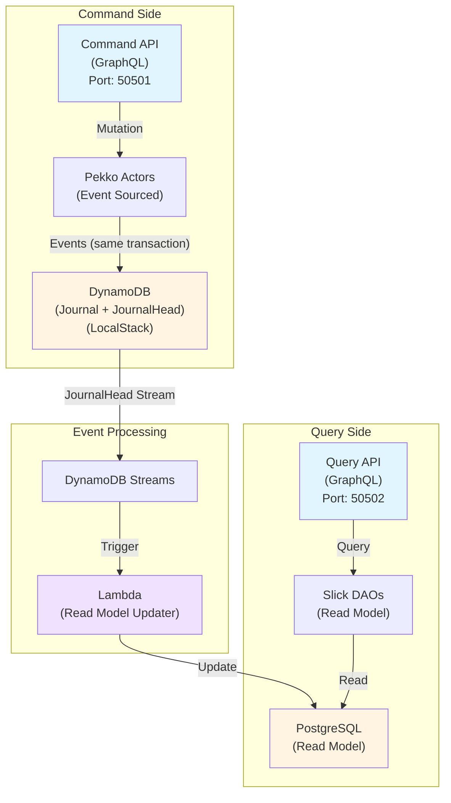

# pekko-cqrs-es-example

Apache Pekkoを使用したCQRS（Command Query Responsibility Segregation）とEvent Sourcingの実践的なサンプル実装です。

## 特徴

- **完全なCQRS/ESアーキテクチャ**: コマンド側とクエリ側を完全に分離
- **イベント駆動**: JournalHead の DynamoDB Streams を使用した、集約単位で順序保証された非同期イベント処理
- **ローカル開発環境**: LocalStackを使用したAWSサービスのローカルエミュレーション
- **GraphQL API**: コマンド側・クエリ側の両方でGraphQL APIを提供
- **自動化テスト**: E2Eテストスクリプトによる完全なフロー検証

## アーキテクチャ概要



### データフロー

1. **コマンド受付**: GraphQL Mutationでコマンドを受け取る（例: `createUserAccount`）
2. **イベント生成**: Pekkoアクターがドメインロジックを実行し、イベントを生成
3. **イベント永続化**: イベントを DynamoDB の `Journal` と `JournalHead` に同一トランザクションで保存
4. **イベント配信**: `JournalHead` テーブルの DynamoDB Streams が、集約ごとの書き込み順にイベントを検知
5. **Read Model更新**: Lambda関数がイベントを処理し、適用済みシーケンス番号と同一トランザクションでPostgreSQLを更新
6. **クエリ実行**: GraphQL Queryでデータを取得（例: `getUserAccounts`）

`Journal` テーブルは集約の復元・リプレイ用です。Read Model の順序保証には、1集約1アイテムとなる `JournalHead` テーブルのストリームを使います。異なる集約間の順序は保証対象外です。

### JournalHead と Read Model Updater

コマンド側は `head.enabled = true` で、ジャーナル行と `JournalHead` の1アイテムを同一の `TransactWriteItems` で書き込みます。`JournalHead` アイテムは次の属性を持ちます。

| 属性 | 内容 |
|---|---|
| `persistence-id` | 集約の persistence id |
| `sequence-nr` | その書き込みで最後に永続化されたシーケンス番号 |
| `events` | その書き込みで発生したイベント（`sequence-nr` と `message` のリスト） |

`read-model-updater` Lambda は `JournalHead` のストリームを `TRIM_HORIZON` から消費します。レコードごとに次の処理を1トランザクションで行います。

1. `read_model_checkpoints` の行を `persistence_id` でロックする
2. checkpoint 以下のシーケンス番号のイベントをスキップする
3. 残りのイベントをシーケンス番号順に `user_accounts` へ適用する
4. 最後に適用したシーケンス番号で checkpoint を更新する

イベント適用と checkpoint 更新が同一トランザクションなので、Lambda が同じバッチを再試行しても二重適用されません。`events` が空のレコードはマイグレーション用のレコードとして扱い、checkpoint を進めずにスキップします。

DynamoDB Streams の保持期間は24時間です。それを超えて停止した場合は `Journal` から Read Model を再構築し、checkpoint を最後にリプレイしたシーケンス番号に合わせてください。

既存の集約がある環境で `head.enabled` を有効にする場合は、先にライブラリの `JournalHeadMigration` で `JournalHead` アイテムを作成してください。ローカル開発でデータを作り直す場合は、ボリュームを削除してから起動します。

```bash
docker compose -f docker-compose-common.yml -f docker-compose-local.yml down -v
./scripts/run-single.sh up
```

未リリースのライブラリを使う場合は、ライブラリ側で `sbt publishLocal` を実行したうえで、次のようにバージョンを上書きできます。

```bash
sbt -Dpekko.persistence.dynamodb.version=1.1.0-20-51dca2ec-SNAPSHOT compile
```

## 技術スタック

### コア技術
- **言語**: Scala 3.6.2
- **ビルドツール**: SBT 1.10.6
- **アクターフレームワーク**: Apache Pekko 1.1.2 (型付きアクター、永続化、クラスター)

### データストア
- **イベントストア**: DynamoDB (`pekko-persistence-dynamodb` 1.1.0 + LocalStack)
- **Read Model**: PostgreSQL 16 + Slick 3.5.2

### API & シリアライゼーション
- **API**: GraphQL (Sangria 4.2.4)
- **シリアライゼーション**: Protocol Buffers (ScalaPB + pekko-protobuf-v3)

### イベント処理
- **イベント処理基盤**: AWS Lambda (LocalStack)
- **非同期処理**: DynamoDB Streams (`JournalHead` テーブル)
- **順序保証**: 集約 (`persistenceId`) 単位。`ParallelizationFactor=1` と checkpoint で重複・順序を制御

### 開発環境
- **ローカルAWS環境**: LocalStack 3.x
- **コンテナ**: Docker & Docker Compose
- **Java**: OpenJDK 17以降

## セットアップ

### 前提条件

- **Docker & Docker Compose**: LocalStack、PostgreSQL、DynamoDBの実行に必要
- **Java**: OpenJDK 17以降（推奨: OpenJDK 21）
- **SBT**: 1.8以降
- **awslocal CLI**: LocalStackとの対話に使用（オプション）

```bash
# awslocal のインストール（オプション）
pip install awscli-local
```

### クイックスタート

#### 1. リポジトリのクローン

```bash
git clone https://github.com/j5ik2o/pekko-cqrs-es-example.git
cd pekko-cqrs-es-example
```

#### 2. 依存関係のインストールとビルド

```bash
# SBTでプロジェクトをビルド
sbt compile

# Dockerイメージをビルド（Command API、Query API、Read Model Updater）
sbt dockerBuildAll
```

#### 3. インフラストラクチャの起動

```bash
# LocalStack、PostgreSQL、DynamoDBを起動し、初期設定を実行
./scripts/run-single.sh up

# 内部で以下が実行されます：
# - docker-compose でインフラ起動
# - DynamoDBテーブル作成
# - PostgreSQLマイグレーション実行
# - Lambda関数のデプロイ
# - Command API、Query APIの起動
```

起動完了後、以下のサービスが利用可能になります：

- **Command API (GraphQL)**: http://localhost:50501/api/graphql
- **Command API Playground**: http://localhost:50501/api/playground
- **Query API (GraphQL)**: http://localhost:50502/api/graphql
- **Query API Playground**: http://localhost:50502/api/playground
- **LocalStack**: http://localhost:4566
- **PostgreSQL**: localhost:5432

#### 4. E2Eテストの実行

```bash
# 完全なCQRS/ESフローをテスト
./scripts/test-e2e.sh

# 出力例:
# === Health Check ===
# ✓ Command API is healthy
# ✓ Query API is healthy
# === Step 1: Create UserAccount via GraphQL Mutation ===
# ✓ UserAccount created successfully!
# === Step 2: Wait for Event Processing ===
# ✓ Event processing time elapsed
# === Step 3: Query UserAccount via GraphQL ===
# ✓ UserAccount found via GraphQL!
# ✓ End-to-End test completed successfully!
```

### 環境の停止とクリーンアップ

```bash
# アプリケーションとインフラを停止
./scripts/run-single.sh down

# 全てのデータを削除（ボリューム含む）
./scripts/run-single.sh down --volumes
```

## 使い方

### GraphQL Playground を使用した対話的操作

ブラウザでGraphQL Playgroundを開きます：

- **コマンドAPI**: http://localhost:50501/api/playground
- **クエリAPI**: http://localhost:50502/api/playground

#### 1. ユーザーアカウントの作成（Command API）

Playgroundで以下のMutationを実行：

```graphql
mutation CreateUserAccount($input: CreateUserAccountInput!) {
  createUserAccount(input: $input) {
    id
  }
}
```

Variables:
```json
{
  "input": {
    "firstName": "太郎",
    "lastName": "山田",
    "emailAddress": "yamada@example.com"
  }
}
```

レスポンス例：
```json
{
  "data": {
    "createUserAccount": {
      "id": "01KAAM3Q5PVKKWW1ZSEH6A68FT"
    }
  }
}
```

#### 2. ユーザーアカウントの取得（Query API）

数秒待ってから、Query API Playgroundで実行：

```graphql
# 全ユーザーの取得
{
  getUserAccounts {
    id
    firstName
    lastName
    fullName
    createdAt
    updatedAt
  }
}

# 特定ユーザーの取得
query GetUserAccount($id: String!) {
  getUserAccount(userAccountId: $id) {
    id
    firstName
    lastName
    fullName
    createdAt
    updatedAt
  }
}

# ユーザー検索
query SearchUsers($term: String!) {
  searchUserAccounts(searchTerm: $term) {
    id
    firstName
    lastName
    fullName
  }
}
```

#### 3. ユーザー名の変更（Command API）

```graphql
mutation RenameUserAccount($input: RenameUserAccountInput!) {
  renameUserAccount(input: $input) {
    id
  }
}
```

Variables:
```json
{
  "input": {
    "userAccountId": "01KAAM3Q5PVKKWW1ZSEH6A68FT",
    "firstName": "次郎",
    "lastName": "田中"
  }
}
```

#### 4. ユーザーアカウントの削除（Command API）

```graphql
mutation DeleteUserAccount($input: DeleteUserAccountInput!) {
  deleteUserAccount(input: $input) {
    id
  }
}
```

Variables:
```json
{
  "input": {
    "userAccountId": "01KAAM3Q5PVKKWW1ZSEH6A68FT"
  }
}
```

### curlを使用したコマンドライン操作

#### ユーザーアカウントの作成

```bash
curl -X POST http://localhost:50501/api/graphql \
  -H "Content-Type: application/json" \
  -d '{
    "query": "mutation CreateUserAccount($input: CreateUserAccountInput!) { createUserAccount(input: $input) { id } }",
    "variables": {
      "input": {
        "firstName": "太郎",
        "lastName": "山田",
        "emailAddress": "yamada@example.com"
      }
    }
  }'
```

#### 全ユーザーの取得

```bash
curl -X POST http://localhost:50502/api/graphql \
  -H "Content-Type: application/json" \
  -d '{
    "query": "{ getUserAccounts { id firstName lastName fullName createdAt updatedAt } }"
  }'
```

#### 特定ユーザーの取得

```bash
curl -X POST http://localhost:50502/api/graphql \
  -H "Content-Type: application/json" \
  -d '{
    "query": "query GetUserAccount($id: String!) { getUserAccount(userAccountId: $id) { id firstName lastName fullName } }",
    "variables": {
      "id": "01KAAM3Q5PVKKWW1ZSEH6A68FT"
    }
  }'
```

## プロジェクト構造

```
pekko-cqrs-es-example/
├── apps/
│   ├── command-api/              # コマンド側HTTP/GraphQLサーバー
│   │   └── src/main/
│   │       ├── resources/
│   │       │   └── application.conf    # Command API設定
│   │       └── scala/
│   │           └── CommandApiMain.scala
│   ├── query-api/                # クエリ側GraphQLサーバー
│   │   └── src/main/
│   │       ├── resources/
│   │       │   └── application.conf    # Query API設定
│   │       └── scala/
│   │           └── QueryApiMain.scala
│   └── read-model-updater/       # Lambda関数（JournalHeadストリーム→Read Model更新）
│       └── src/main/
│           ├── resources/
│           │   └── application.conf    # Lambda設定
│           └── scala/
│               └── LambdaHandler.scala
├── modules/
│   ├── command/                  # コマンド側モジュール
│   │   ├── domain/               # ドメインエンティティ、値オブジェクト、イベント
│   │   │   └── src/main/scala/
│   │   │       └── users/
│   │   │           ├── UserAccount.scala          # 集約ルート
│   │   │           ├── UserAccountEvent.scala     # ドメインイベント
│   │   │           └── UserAccountId.scala        # 値オブジェクト
│   │   ├── use-case/             # アプリケーションサービス
│   │   └── interface-adapter/    # Pekkoアクター、永続化、GraphQLエンドポイント
│   │       └── src/main/
│   │           ├── protobuf/     # Protocol Buffer定義
│   │           └── scala/
│   │               └── aggregate/
│   │                   └── UserAccountAggregateActor.scala
│   ├── query/                    # クエリ側モジュール
│   │   ├── interface-adapter/    # GraphQL API、Slick DAO
│   │   │   └── src/main/scala/
│   │   │       ├── dao/          # Slick DAOs（自動生成）
│   │   │       └── graphql/      # GraphQL Schema & Resolvers
│   │   └── flyway-migration/     # データベースマイグレーション
│   │       └── src/main/resources/db/migration/
│   └── infrastructure/           # 共有インフラコード
│       └── src/main/scala/
│           └── serialization/    # カスタムシリアライザ
├── scripts/
│   ├── run-single.sh             # シングルノードモード起動スクリプト
│   ├── test-e2e.sh               # E2Eテストスクリプト
│   └── test-graphql.sh           # GraphQLテストスクリプト
├── tools/
│   └── dynamodb-setup/           # DynamoDBテーブル定義とセットアップ
│       ├── Makefile
│       └── tables.tf
├── docker-compose-common.yml     # 共通インフラ定義
├── docker-compose-single.yml     # シングルノードモード定義
├── build.sbt                     # SBTビルド定義
└── CLAUDE.md                     # Claude Code向けプロジェクトガイド
```

## 開発ワークフロー

### 1. 新機能の追加

#### ドメインイベントの追加

1. `modules/command/domain/src/main/scala/users/UserAccountEvent.scala` にイベントを追加
2. `modules/command/interface-adapter-contract/src/main/protobuf/` にProtobuf定義を追加
3. `sbt compile` でProtobufコードを生成
4. シリアライザを更新（必要に応じて）

#### GraphQL APIの追加

**コマンド側（Mutation）:**
1. `modules/command/interface-adapter/src/main/scala/graphql/` にスキーマとリゾルバを追加

**クエリ側（Query）:**
1. `modules/query/flyway-migration/src/main/resources/db/migration/` にマイグレーションを追加
2. `sbt migrateQuery` でマイグレーション実行
3. `sbt "queryInterfaceAdapter/generateAllWithDb"` でDAOを再生成
4. `modules/query/interface-adapter/src/main/scala/graphql/` にスキーマとリゾルバを追加

### 2. コード品質チェック

```bash
# コードフォーマット
sbt fmt

# フォーマットとリントのチェック
sbt lint

# コンパイル
sbt compile

# テスト実行
sbt test

# カバレッジ付きテスト
sbt testCoverage
```

### 3. データベース操作

```bash
# マイグレーション実行
sbt migrateQuery

# マイグレーション情報表示
sbt infoQuery

# マイグレーション検証
sbt validateQuery

# クリーン後マイグレーション
sbt cleanMigrateQuery

# DAO生成（テーブル定義から自動生成）
sbt "queryInterfaceAdapter/generateAllWithDb"
```

### 4. 特定モジュールのテスト

```bash
# コマンドドメインのテスト
sbt "commandDomain/test"

# クエリインターフェースアダプターのテスト
sbt "queryInterfaceAdapter/test"

# 特定のテストクラスのみ実行
sbt "testOnly io.github.j5ik2o.pcqrses.domain.users.UserAccountSpec"
```

## テスト

### 単体テスト

```bash
# 全テスト実行
sbt test

# カバレッジレポート生成
sbt testCoverage
```

### E2Eテスト

```bash
# 完全なCQRS/ESフローをテスト
./scripts/test-e2e.sh
```

E2Eテストスクリプトは以下を自動実行します：

1. **ヘルスチェック**: Command APIとQuery APIの稼働確認
2. **ユーザー作成**: GraphQL Mutationでユーザーアカウント作成
3. **イベント処理待機**: Lambda関数が JournalHead ストリームのイベントを処理するまで待機
4. **データ取得**: GraphQL Queryでデータ取得を試行（リトライ機能付き）
5. **整合性検証**: 作成したデータが正しく取得できることを確認

環境変数でテストの動作をカスタマイズできます：

```bash
# リトライ回数とタイムアウトのカスタマイズ
E2E_MAX_RETRIES=15 \
E2E_RETRY_DELAY=5 \
E2E_WAIT_AFTER_CREATE=10 \
./scripts/test-e2e.sh

# 別ホストでテスト
COMMAND_API_HOST=192.168.1.100 \
QUERY_API_HOST=192.168.1.100 \
./scripts/test-e2e.sh
```

### GraphQLテスト

```bash
# GraphQL APIの基本動作テスト
./scripts/test-graphql.sh
```

## トラブルシューティング

### LocalStackが起動しない

```bash
# LocalStackのログを確認
docker logs localstack

# LocalStackを再起動
docker-compose -f docker-compose-common.yml restart localstack

# ヘルスチェック
curl http://localhost:4566/_localstack/health
```

### Lambda関数がイベントを処理しない

```bash
# Lambda関数のログを確認（CloudWatch Logs）
awslocal logs tail /aws/lambda/read-model-updater --follow

# JournalHead の DynamoDB Streams の設定を確認
awslocal dynamodbstreams list-streams
awslocal dynamodb describe-table --table-name JournalHead

# Lambda関数のイベントソースマッピングを確認
awslocal lambda list-event-source-mappings
```

### PostgreSQLに接続できない

```bash
# PostgreSQLコンテナのログを確認
docker logs postgres

# 接続テスト
psql -h localhost -p 5432 -U postgres -d postgres

# マイグレーション状態を確認
sbt infoQuery
```

### DynamoDBにデータが保存されない

```bash
# テーブルの存在確認
awslocal dynamodb list-tables

# JournalHead の内容確認（events と sequence-nr が入っていること）
awslocal dynamodb scan --table-name JournalHead

# Journal と JournalHead のテーブル定義の確認
awslocal dynamodb describe-table --table-name Journal
awslocal dynamodb describe-table --table-name JournalHead

# Read Model の checkpoint 確認
psql -h localhost -p 50504 -U postgres -d p-cqrs-es_development \
  -c 'select * from read_model_checkpoints order by updated_at desc;'
```

### ビルドエラーが発生する

```bash
# クリーンビルド
sbt clean compile

# 依存関係の更新
sbt update

# Protobufコードの再生成
sbt clean compile

# Dockerイメージの再ビルド
sbt clean dockerBuildAll
```

### E2Eテストが失敗する

```bash
# 詳細ログでテストを実行
bash -x ./scripts/test-e2e.sh

# 待機時間を延長してテスト
E2E_WAIT_AFTER_CREATE=15 E2E_MAX_RETRIES=20 ./scripts/test-e2e.sh

# 各サービスの状態を確認
curl http://localhost:50501/api/graphql  # Command API
curl http://localhost:50502/api/graphql  # Query API
docker ps                                # 全コンテナの状態
```

### "ポートが既に使用されています" エラー

```bash
# ポートを使用しているプロセスを確認
lsof -i :50501  # Command API
lsof -i :50502  # Query API
lsof -i :4566   # LocalStack
lsof -i :5432   # PostgreSQL

# プロセスを終了
kill -9 <PID>

# または全て停止してクリーンスタート
./scripts/run-single.sh down
./scripts/run-single.sh up
```

## アーキテクチャの詳細

### イベントソーシング

このプロジェクトでは、全ての状態変更をイベントとして記録します：

1. **コマンド受信**: `CreateUserAccount`
2. **ドメインロジック実行**: `UserAccount` 集約でビジネスルールを検証
3. **イベント生成**: `UserAccountEvent.Created_V1`
4. **イベント永続化**: DynamoDBに保存（Pekko Persistenceが`PersistentRepr`でラップ）
5. **状態復元**: 過去のイベントを再生して現在の状態を復元可能

### CQRS（コマンドクエリ責任分離）

**コマンド側（書き込み）:**
- Pekko型付きアクターで集約を実装
- イベントソーシングで状態を管理
- DynamoDBをイベントストアとして使用
- GraphQL Mutationでコマンドを受け付け

**クエリ側（読み取り）:**
- PostgreSQLに非正規化されたRead Modelを構築
- Slick DAOで高速なクエリを実現
- GraphQL Queryでデータを提供
- Lambda関数でイベントからRead Modelを非同期更新

### Read Model更新の仕組み

1. **イベント検知**: DynamoDB StreamsがJournalテーブルの変更を検知
2. **Lambda起動**: read-model-updaterが起動
3. **デシリアライズ**:
   - `PersistentRepr`をデシリアライズ（Pekkoの内部構造）
   - ペイロードから実際のイベント（`UserAccountEvent`）を取り出し
4. **Read Model更新**: PostgreSQLのuser_accountsテーブルを更新
5. **クエリ可能**: 更新されたデータをQuery APIで取得可能

### Protocol Buffers シリアライゼーション

イベントとスナップショットはProtocol Buffersでシリアライズされます：

- **定義**: `modules/command/interface-adapter-contract/src/main/protobuf/`
- **生成**: `sbt compile` でScalaコードを自動生成
- **使用**: Pekko Persistenceのカスタムシリアライザで使用
- **バージョニング**: イベントスキーマの進化に対応（例: `Created_V1`）

## パフォーマンスとスケーラビリティ

### 水平スケーリング

- **Pekko Cluster**: 複数ノードでアクターを分散（`run-cluster.sh`で実行）
- **Cluster Sharding**: エンティティIDでアクターを自動分散
- **イベント処理**: Lambda関数は自動的にスケール

### 最適化ポイント

- **Read Model**: クエリ用に最適化されたスキーマ設計
- **イベントスナップショット**: 大量イベントからの状態復元を高速化
- **接続プール**: Slick/HikariCPで効率的なDB接続管理
- **非同期処理**: イベント処理は完全に非同期

## セキュリティ考慮事項

このサンプルプロジェクトには以下のセキュリティ機能は**含まれていません**：

- 認証・認可
- API レート制限
- 入力バリデーション（最小限のみ）
- 暗号化（転送時・保管時）

本番環境では、これらのセキュリティ対策を必ず実装してください。

## ライセンス

LICENSEファイルを参照してください。

## 参考資料

- [Apache Pekko](https://pekko.apache.org/)
- [CQRS Journey](https://docs.microsoft.com/en-us/previous-versions/msp-n-p/jj554200(v=pandp.10))
- [Event Sourcing](https://martinfowler.com/eaaDev/EventSourcing.html)
- [LocalStack](https://localstack.cloud/)
- [GraphQL](https://graphql.org/)
- [Protocol Buffers](https://protobuf.dev/)

## 貢献

プルリクエストを歓迎します。大きな変更の場合は、まずIssueを開いて変更内容を議論してください。

## サポート

問題が発生した場合は、GitHubのIssueを作成してください。
